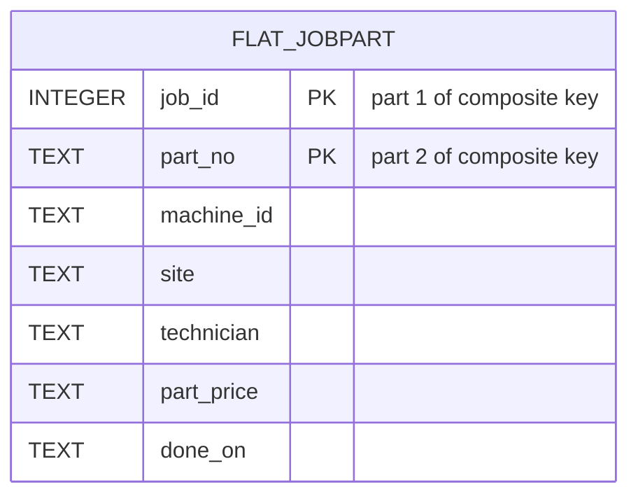
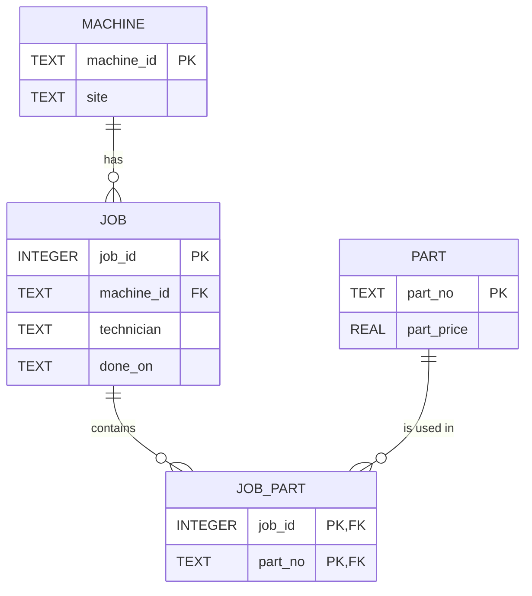

# Module 5 — Normalization Notes

## Round 1 — Functional dependencies

The five-row extract represents one row per job-part combination. The following
dependencies are assumptions of the intended domain, not facts that can be
proved from only five rows:

| Functional dependency | Classification | Reason |
|---|---|---|
| `job_id → machine_id` | Domain assumption | A job belongs to one machine. |
| `job_id → technician` | Domain assumption | The studio model assigns one technician to a job. |
| `job_id → done_on` | Domain assumption in the full schema | A job has one completion date. |
| `machine_id → site` | Domain assumption | Each machine is located at one site at a time. |
| `part_no → part_price` | Domain assumption | The exercise treats the part catalog price as one current value. |
| `job_id → site` | Logically derived | `job_id → machine_id` and `machine_id → site` imply it transitively. |

Under the additional rule that the same part occurs at most once in one job,
`(job_id, part_no)` is a candidate key. Together the two attributes determine
the job attributes, the machine site, and the part price. It is minimal because
`job_id` alone does not determine which part row is meant, while `part_no` alone
does not determine which job used it.

The sample happens to make `machine_id → technician` and
`part_price → part_no` look plausible, but they are not justified domain rules.
A machine may have different technicians on different jobs, and two different
parts may have the same price. Likewise, any dependency based only on every row
having the site Gütersloh is an observed pattern, not a business rule.

## Original flat design

The intended key is `(job_id, part_no)`. The flat example has no separate
machine, part, or job entities, so it cannot declare foreign keys to them. Site,
technician, and price are repeated on many rows.

## Normalized 3NF design

A machine can have many jobs. A job can use many parts, and one part can be used
by many jobs, so `job_part` resolves that many-to-many relationship. Each site,
technician assignment, and part price is stored once in its authoritative
entity instead of once per job-part row.

### Gate answer — which arrow disappears?

The direct storage arrows from a flat job-part row to `site` and `part_price`
disappear. They are replaced by relationships to `machine` and `part`. The
underlying functional dependencies do not stop being true; normalization moves
each dependent fact to the table where its determinant is the key.

## Initial analysis and LLM comparison

No separate handwritten student FD list was preserved before AI assistance. The
initial working analysis above is therefore an LLM-assisted draft that requires
student review, not evidence of an independent classroom prediction.

An independent LLM cross-check agreed on `job_id → machine_id`,
`job_id → technician`, `machine_id → site`, `part_no → part_price`, the
transitive `job_id → site`, and `(job_id,part_no)` as the intended candidate
key. The cross-check also proposed possible sample-only arrows such as
`technician → machine_id`. That proposal is rejected as a domain dependency:
the five rows are insufficient, and technicians may work on more than one
machine. The comparison shows why observed repetition must not automatically be
promoted to a business rule.

## Normal forms in this implementation

- **1NF:** every stored value is atomic; no comma-separated part list exists.
- **2NF:** `part_price` is removed from the composite-key `job_part` relation
  because it depends only on `part_no`.
- **3NF:** `site` is stored in `machine`, not transitively on every job or
  job-part row through `machine_id`.

`SELECT DISTINCT` loads one row per job into `job`. This assumes every flat row
for a job agrees on machine, technician, and date. If a job had conflicting
technicians, `DISTINCT` would produce multiple source rows with the same
`job_id`, and the primary key would expose the invalid decomposition input.

### Why `part` has 10 rows

The recursive `p(k)` generator produces only `k=1…10`. Therefore
`(k % 40) + 1` produces 2…11: ten values. The `% 40` expression describes the
possible cycle, but this workload never supplies `k=11…40`. The measured part
count is 10.

## Round 2 — Anomalies

The saved output is in [`evidence/anomaly-results.txt`](evidence/anomaly-results.txt).

- **Update anomaly:** `cnc-01` appears three times. Updating only one row creates
  one Bielefeld row and two Gütersloh rows. The normalized update changes one
  authoritative machine row.
- **Insert anomaly:** SQLite accepts a standalone `P-0099` placeholder in the
  unconstrained flat table, but its job, machine, site, and technician fields
  must be NULL or invented. The normalized `part` table stores it cleanly.
- **Delete anomaly:** `P-0002` occurs once. Deleting that flat row removes the
  only stored price, while the normalized part row remains.

Prepared Round 2 gate question: “Try to break one of my three statements.” No
actual neighboring-pod response is documented.

## Rounds 3–5 — Measured findings

The generator produced 200,000 flat rows, 50 machines, 10 parts, 20,000 jobs,
200,000 job-part rows, and 200,000 report rows. Two-way `EXCEPT` checks found no
difference between the flat relation and normalized reconstruction.

The normalized dashboard median was 121.0052 ms. The indexed denormalized report
median was 151.9686 ms, so denormalization was about 25.6% slower on this run.
After dropping the machine index, the report median improved to 112.1664 ms.
This negative index result occurs because the query reads a large share of the
table and still needs temporary B-trees for grouping and ordering.

Updating `cnc-02` changed one normalized row but 4,000 report rows. `dbstat`
reported 3,976.0 KB for normalized base tables and 10,832.0 KB for the report
table, excluding indexes. Full evidence is linked from the README.

### Round 5 gate preparation

Before showing the measurement, the model predicts one normalized row because
`machine_id` is the key of `machine`, and 4,000 report rows because each of 50
machines owns 200,000 / 50 report rows. The SQL row count confirms that
prediction. In contrast, update milliseconds are measured and vary by run, and
storage is measured from `dbstat` pages rather than derived from the row count.
No classmate's guess is recorded or invented.

### Other prepared gate answers

- **Round 3:** `part` has 10 rows because `k` has ten actual values.
- **Round 4:** plans can differ with SQLite version, indexes, statistics, and
  query formulation; the saved plans show the actual choices here.
- **Round 6:** if a machine moves after report creation, the report is stale
  until a controlled refresh rebuilds it.
- **Round 7:** curiosity sharing requires genuine student confirmation.

## Round 7 — Prepared curiosities

These are technical questions derived from the actual experiment:

1. Why does `CROSS JOIN` turn 20,000 jobs and 10 parts into 200,000 rows?
   Source: [`setup.sql`](setup.sql).
2. Why are there 10 parts rather than 40? Source:
   [`evidence/row-counts.txt`](evidence/row-counts.txt).
3. Why does `printf('%.2f', ...)` create TEXT that must later be cast to REAL?
   Source: [`setup.sql`](setup.sql).
4. How would a conflicting technician for one job break the `DISTINCT` load?
   Source: the `job` insertion in [`setup.sql`](setup.sql).
5. Why was the report slower even though it avoided joins? Source:
   [`evidence/benchmark-summary.md`](evidence/benchmark-summary.md).
6. Why did removing `ix_report_machine` improve this full-scan aggregation?
   Source: [`evidence/query-plans.txt`](evidence/query-plans.txt).
7. Why is the report table 2.72 times the table storage of the normalized base
   tables? Source: [`evidence/storage-results.txt`](evidence/storage-results.txt).
8. How can a stale report be prevented when a machine moves? Source:
   [`recommendation.md`](recommendation.md).

These curiosities are **prepared, not documented as shared**. No nearest-pod
gate, classmate response, Discord post, or harvest swap is claimed.

## Development correction

The first benchmark dry run exposed a harness problem rather than a database
result: Python reused a cached `EXPLAIN QUERY PLAN` statement after the report
index was dropped, so the apparent unindexed plan still named the index. That
run was discarded. The connection now uses `cached_statements=0`, the benchmark
was rerun, and the saved unindexed plan correctly shows `SCAN report_jobpart`.

## AI-assistance disclosure

Functional-dependency classification, benchmark-harness design, documentation,
and test planning were LLM-assisted. The resulting claims were checked against
the official workbook, executable SQL, row-count and equivalence assertions,
captured SQLite plans, raw timing samples, `dbstat`, and automated tests. The
repository does not claim an independently handwritten pre-AI FD prediction.
