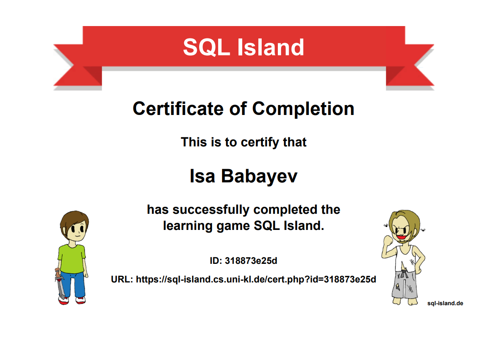

# Module 01 - Task 5: SQL Island

## Completion evidence

I successfully finished the SQL Island learning game and received its Certificate of Completion on 19 October 2026.

[View my completion certificate](https://sql-island.cs.uni-kl.de/cert.php?id=318873e25d)

## 1. What did I learn about databases and SQL?

SQL Island helped me understand how databases organize information into tables and how SQL is used to retrieve information. I practiced finding information about villages and inhabitants through SQL queries.

I also learned that writing the correct query requires understanding how the information is organized.

## 2. Which SQL commands and patterns did I use?

I practiced SELECT and FROM to retrieve information from tables.

Examples from my exercises:

SELECT * FROM village;

SELECT * FROM inhabitant;

I also learned how SQL queries can be used to filter, organize, and combine information.

[Add the other commands you actually used during the game, for example WHERE, ORDER BY, JOIN, GROUP BY, UPDATE, or DELETE.]

## 3. Explain the database concepts in my own words

**Table:** A collection of related information, organized into rows and columns.

**Row:** One individual record in a table, such as one inhabitant.

**Column:** One attribute of a record, such as a person's name or job.

**Query:** An instruction written in SQL to retrieve or work with information in a database.

## 4. What surprised me? What is still confusing?

[Describe something you personally found surprising during the game.]

[Describe a SQL concept that you still find difficult, or explain what became clearer after completing the game.]

## Conclusion

I completed the game and earned its certificate. This exercise gave me practical experience with SQL before working on larger SQLite databases in Module 1.
