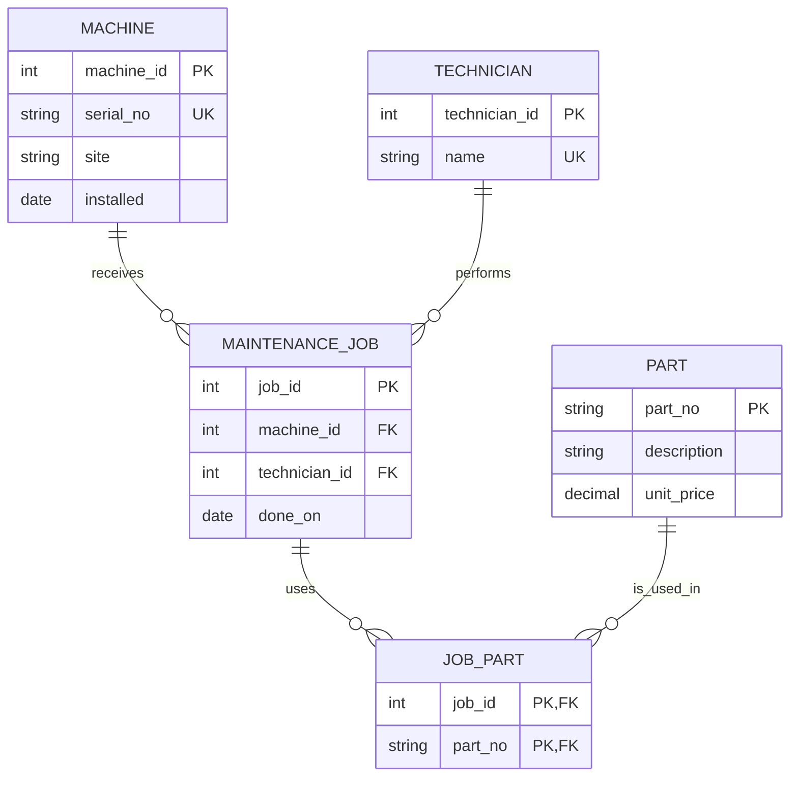

# Legacy ER audit

The source fixture is [legacy_setup.sql](legacy_setup.sql). It contains three
tables but no declared keys, nullability rules, uniqueness, checks, or foreign
keys. Column names suggest relationships; SQLite does not enforce those
suggestions.

## Entities and attributes

| Entity | Legacy representation | Attributes | Proposed key and role |
|---|---|---|---|
| Machine | `machine` table | machine name, serial number, site, installation date | `machine_id` surrogate PK; `serial_no` natural key with UNIQUE |
| Part | `part` table | part number, description, unit price | `part_no` natural PK |
| MaintenanceJob | `maint_job` table | job ID, machine text, technician text, date, parts text | `job_id` PK; event with FKs to machine and technician |
| Technician | implied by repeated text only | technician ID, name | `technician_id` PK; consistent identity for a person |
| JobPart | hidden inside `parts_used` | job ID, part number | composite PK; junction entity for the m:n relationship |

The legacy `machine_name` is not reliable as a key: it has no constraint and
contains `RANDOM-NAME`. A surrogate machine ID isolates references from name
changes, while serial number remains uniquely constrained.

## Actual schema versus intended model

Actual schema:

- Any column can be null.
- Duplicate machine names, serials, part numbers, and job IDs are allowed.
- A job may name a machine that does not exist.
- Prices and dates are unrestricted text.
- A comma-separated value hides several logical values in one cell.

Likely intent:

- Each maintenance job belongs to one machine and one technician.
- A machine and a technician may each be associated with many jobs.
- Jobs and parts form a many-to-many relationship.
- Serial and part numbers identify real things uniquely.

## Corrected conceptual model

The Mermaid relationship markers match the executable foreign keys in
[corrected-schema.sql](corrected-schema.sql). Zero jobs/uses are allowed at a
parent end; each job has exactly one machine and technician; every JobPart has
exactly one job and part.

## Cardinality evidence

Queries are in [cardinality-audit.sql](cardinality-audit.sql), with captured
output in [cardinality-results.txt](cardinality-results.txt).

| Question | Observed result |
|---|---|
| Parts encoded per job | job 1 has 2; jobs 2 and 3 have 1; job 4 has NULL |
| Jobs with multiple parts | 1 |
| Machines named by multiple jobs | `cnc-01` has 2 |
| Distinct technician strings | 3 |
| Parts occurring in multiple jobs after tokenization | `P-1001` occurs in 2 |
| Jobs matching a machine | 3 of 4; 1 orphan |

The workbook expression returns NULL for job 4 because SQLite propagates NULL
through string functions. That is a useful distinction from a count of zero.

## Observed, intended, and enforced cardinality

- **Observed:** the small fixture happens to show a machine with two jobs, a job
  with two parts, and a part in two jobs.
- **Intended:** Machine–MaintenanceJob and Technician–MaintenanceJob are 1:n;
  MaintenanceJob–Part is m:n through JobPart. The separate nameplate exercise
  is 1:1.
- **Enforced in the legacy schema:** none of these relationships. Every
  similarly named or list-valued column is plain TEXT.
- **Enforced in the corrected schema:** non-null foreign keys enforce the child
  side of both 1:n relationships. Two foreign keys plus a composite primary key
  enforce the m:n junction and prevent a duplicate part in a job.

The legacy schema has no 1:1 relationship. It only hints at two 1:n
relationships and hides the m:n relationship in `parts_used`.
