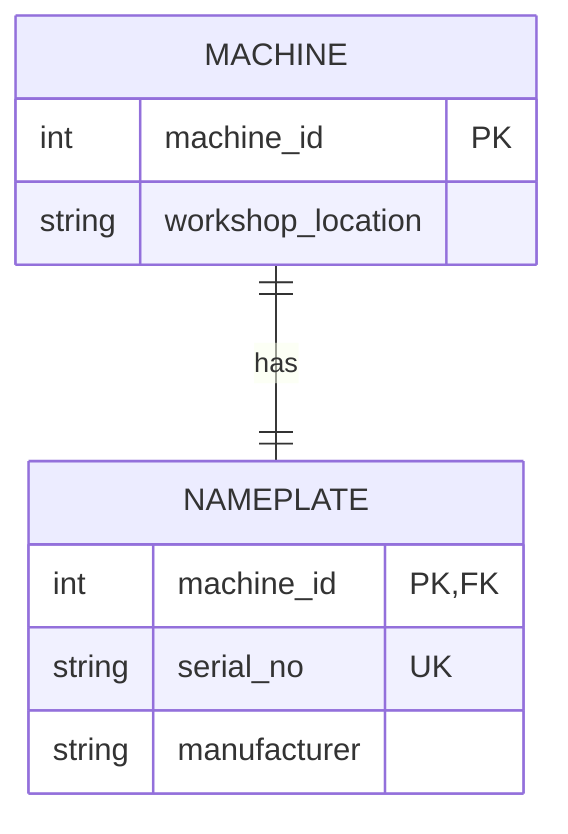
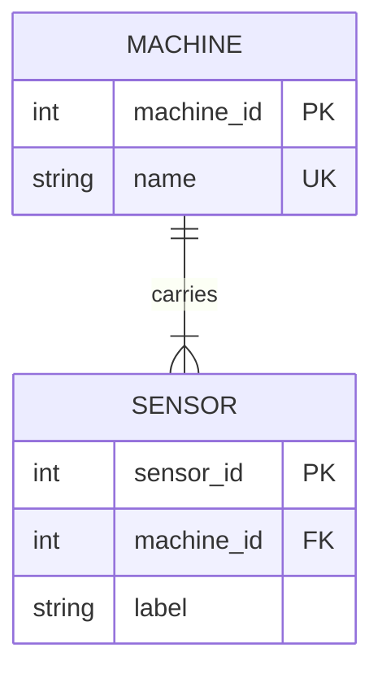
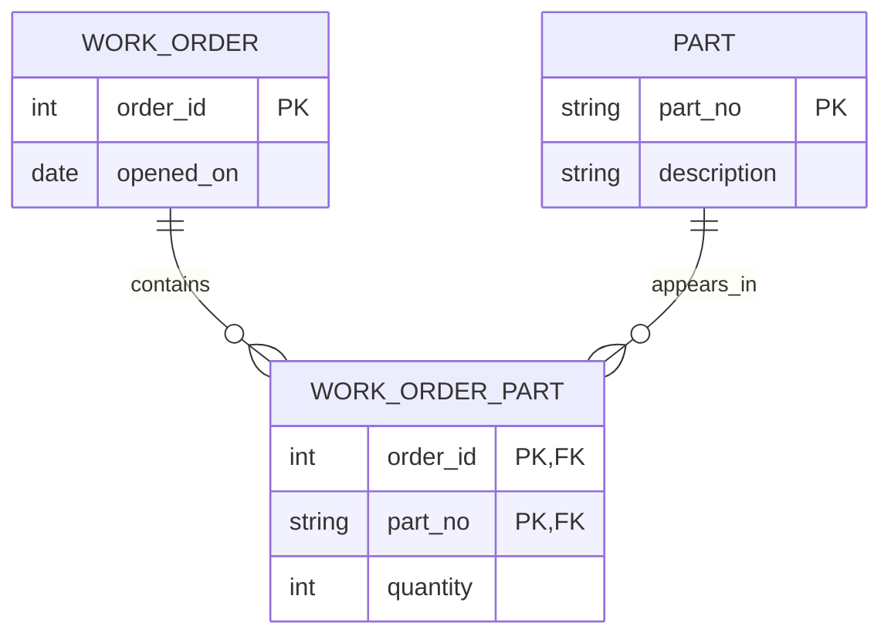
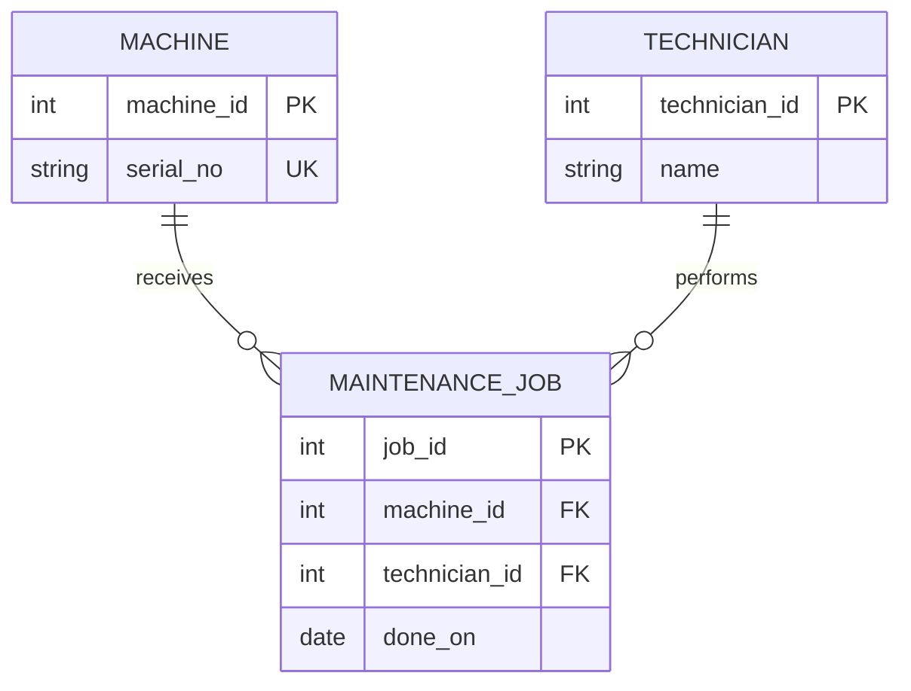

# Four ER modeling exercises

Mermaid notation uses `||` for exactly one, `o|` for zero or one, and
`|{` for one or more.

## 1. One-to-one: machine and nameplate



`Nameplate.machine_id` is both its primary key and a foreign key to Machine.
That makes each nameplate belong to only one machine and prevents two
nameplates for one machine. `serial_no UNIQUE NOT NULL` gives the natural
identifier its own guarantee. A separate entity is useful when nameplate data
has its own lifecycle, provenance, or more fields; if it is only two inseparable
values, embedding them in Machine is simpler.

The foreign key and uniqueness enforce *at most one* nameplate per machine.
They do not, by themselves, force every Machine row to have a Nameplate row.
“Exactly one” across both tables needs a transaction/workflow rule, a deferred
constraint in a database that supports it, or a single combined table.

## 2. One-to-many: machines and sensors



```sql
CREATE TABLE machine (
  machine_id INTEGER PRIMARY KEY,
  name TEXT NOT NULL UNIQUE
);
CREATE TABLE sensor (
  sensor_id INTEGER PRIMARY KEY,
  machine_id INTEGER NOT NULL REFERENCES machine(machine_id),
  label TEXT NOT NULL
);
```

Machine is the parent; Sensor is the child and therefore carries the foreign
key. [The executable proof](sketch-proof.sql) inserts two sensors for machine 1,
counts 2, and rejects an orphan sensor for machine 999.

## 3. Many-to-many: work orders and parts



```sql
CREATE TABLE work_order_part (
  order_id INTEGER NOT NULL REFERENCES work_order(order_id),
  part_no TEXT NOT NULL REFERENCES part(part_no),
  quantity INTEGER NOT NULL CHECK (quantity > 0),
  PRIMARY KEY (order_id, part_no)
);
```

The junction row represents “this order uses this part.” Its composite primary
key rejects a second row with the same pair; quantity belongs on that one
relationship row if more than one physical unit is used.

## 4. Maintenance job as an entity



MaintenanceJob connects a machine and a technician, but it should be an entity
because it has its own identity, date, and later relationships to parts,
documents, and costs. Machine and Technician use stable surrogate keys.
`done_on` is an attribute of the job. The two non-null foreign keys say each
job has exactly one machine and technician, while either parent may have zero
or many jobs.
