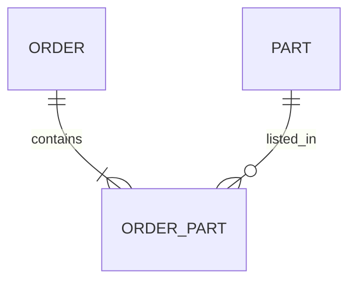
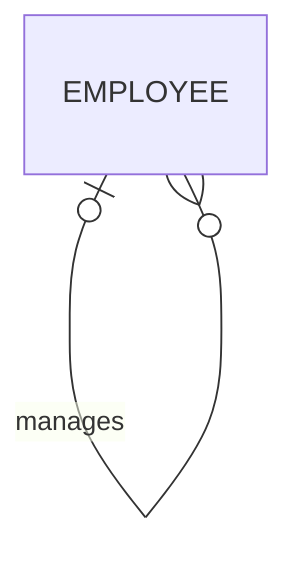
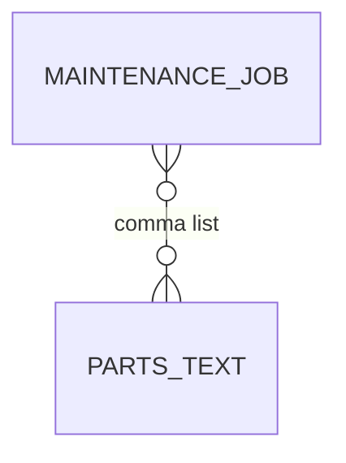
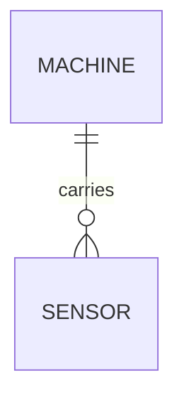

# Optional stretcher: Mermaid ER lab

This file is optional technical exploration. No Discord sharing is claimed.

## Good: explicit associative entity

Based on the junction-table pattern in the [official Module 2 workbook](https://github.com/iotempire/iotempire-teaching/blob/main/full-classes/hsbi-databases-10d/modules/02-data-contracts-and-legacy-schemas.md)
and notation from the [Mermaid ER documentation](https://mermaid.js.org/syntax/entityRelationshipDiagram.html).



It is good because the m:n relationship becomes rows that can carry quantity
and a composite key.

## Strange but valid: recursive relationship



The same entity participates twice with different roles. This is legitimate
but needs clear labels and a nullable `manager_id` self-reference.

## Incorrect/confusing example



`PARTS_TEXT` is not a real entity and the diagram invents an enforced m:n
relationship that the legacy schema does not have. The correction is the
`JOB_PART` entity in [er-audit.md](er-audit.md).

## Schema to diagram and back

Input schema:

```sql
CREATE TABLE sensor (
  sensor_id INTEGER PRIMARY KEY,
  machine_id INTEGER NOT NULL REFERENCES machine(machine_id)
);
```

Derived diagram:



Round-tripped DDL preserves the FK and non-null child participation, but the
diagram alone does not fully preserve column types, constraint names, cascade
actions, or whether every machine must have a sensor. The `o{` parent-side
minimum is a business assumption, not derivable from the child FK.

## Cardinality and inheritance critique

“Exactly four wheels” is normally a changing business constraint, not a new ER
cardinality category: spare wheels, trailers, and six-wheel vehicles break the
shortcut. Likewise, inheritance is unnecessary when variants have nearly the
same fields. [The EER SQL comparison](eer-stretcher.sql) recommends a checked
type discriminator for this small domain and records what that choice enforces.
