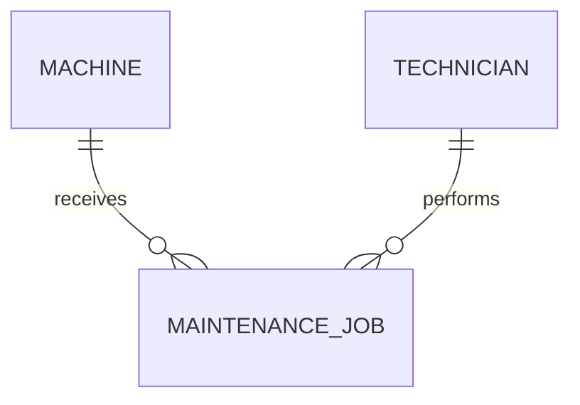
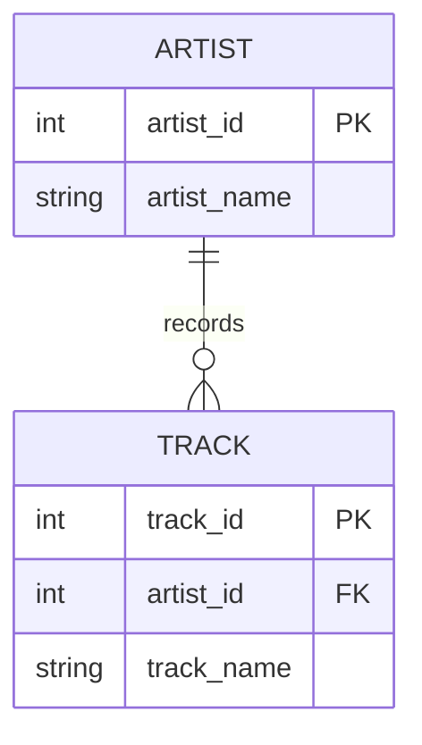

# Study log: data contracts and legacy schemas

This is technical preparation and AI-assisted verification. It does **not**
claim that the required personal or pod study session occurred.

## Learning references

| Source | Publisher | Concept and relevance |
|---|---|---|
| [Official Module 2 workbook](https://github.com/iotempire/iotempire-teaching/blob/main/full-classes/hsbi-databases-10d/modules/02-data-contracts-and-legacy-schemas.md) | IoT Empire / HSBI course material | Primary assignment specification and legacy fixture; it frames AI statements as hypotheses to test. |
| [Entity–relationship model](https://en.wikipedia.org/wiki/Entity%E2%80%93relationship_model) | Wikipedia contributors | Overview of entities, attributes, relationships, and common notation. Used as a starting reference, not as executable proof. |
| [Entity Relationship Diagrams](https://mermaid.js.org/syntax/entityRelationshipDiagram.html) | Mermaid project | Defines renderable ER syntax and crow's-foot markers used in this portfolio. |
| [Enhanced ER model](https://en.wikipedia.org/wiki/Enhanced_entity%E2%80%93relationship_model) | Wikipedia contributors | Explains generalization/specialization and subtype ideas beyond basic ER modeling. |
| [First normal form](https://en.wikipedia.org/wiki/First_normal_form) | Wikipedia contributors | Explains why a field should not contain a repeating list of part identifiers. |
| [SQLite foreign-key support](https://www.sqlite.org/foreignkeys.html) | SQLite project | Official explanation of parent/child keys and the need to enable enforcement per connection. |
| [SQLite CREATE TABLE](https://www.sqlite.org/lang_createtable.html) | SQLite project | Documents PRIMARY KEY, UNIQUE, NOT NULL, CHECK, and FOREIGN KEY constraints. |
| [Pydantic fields](https://docs.pydantic.dev/latest/concepts/fields/) and [validators](https://docs.pydantic.dev/latest/concepts/validators/) | Pydantic project | Basis for required fields, ranges, patterns, date parsing, and custom list validation. |
| [SQLAlchemy metadata](https://docs.sqlalchemy.org/en/21/core/metadata.html) and [constraints](https://docs.sqlalchemy.org/en/21/core/constraints.html) | SQLAlchemy project | Defines tables, columns, foreign keys, checks, uniqueness, and DDL creation. |

## Questions and verified answers

| Question | Verified answer | Evidence type |
|---|---|---|
| Entity or attribute? | Give it an entity when it needs identity, lifecycle, attributes, or relationships of its own. Context decides borderline cases. | Reference plus MaintenanceJob design |
| When use a natural key? | When it is stable, compact, known, and truly unique. Otherwise use a surrogate and retain UNIQUE on the business identifier. | Reference and corrected DDL |
| Why are duplicate natural keys dangerous? | One identifier resolves to multiple rows, causing ambiguous updates and duplicate join results. | Experiment: P-1003 yields two join rows |
| How model 1:1, 1:n, m:n? | UNIQUE FK; FK on many side; junction table with two FKs and unique/composite key, respectively. | Four sketches and SQL |
| Why does a comma list violate 1NF? | One column stores multiple independent part values, so each cannot be keyed or constrained. | Reference and failed naive join |
| Why do missing FKs create orphans? | Text can be inserted without a matching parent. | Experiment: job 3 / cnc-05 |
| What does SQLite enforce automatically? | Declared PK, UNIQUE, NOT NULL, and CHECK rules; FK enforcement must be enabled for each connection. | SQLite docs and `foreign_keys=1` run |
| What must the application validate? | Input shape and domain semantics such as prefixes, calendar dates, decimal bounds, and duplicate list items; the DB still validates shared integrity. | Pydantic and database tests |

## LLM-assisted questions and checks

These exact prompts were answered during implementation. Summaries are not
accepted as proof; each was checked against SQL or documentation.

### Prompt 1

> Given the supplied legacy schema, what entities and hidden relationships does
> it probably intend, and which relationships are actually enforced?

Response summary: Machine, Part, MaintenanceJob, and implied Technician were
identified, with JobPart needed for the hidden m:n. The response warned that
matching column names are not constraints. Verification: `sqlite_master`
showed no keys or foreign keys, and job 3 proved an orphan can exist. No
unsupported relationship was treated as enforced.

### Prompt 2

> Why does parts_used = 'P-1001,P-1002' violate 1NF, and what corrected schema
> should replace it?

Response summary: the field contains multiple values and should become
`job_part(job_id, part_no)`. Verification: the naive equality join lost job 1;
the corrected composite primary key test rejected a duplicate pair. Ambiguity:
the legacy field does not record quantity, so quantity cannot be reconstructed.

### Prompt 3

> Is unit_price TEXT harmless in SQLite if all current values look numeric?

Response summary: no; comparisons may use text ordering and SQLite type
affinity is not domain validation. Verification: `'9.90' < '15'` returned 0,
while casting both to numeric logic returned 1. The initial broad claim
“numeric comparisons always fail” would be too strong: behavior depends on
operands and affinity, so the recorded counterexample is the precise evidence.

### Prompt 4

> Can a foreign key and UNIQUE constraint guarantee every machine has exactly
> one nameplate?

Response summary: they guarantee that a nameplate has a valid machine and at
most one nameplate can point to that machine, but cannot force creation of a
child row for every parent. Verification: this follows from the direction of
the FK and SQLite constraint semantics. “Exactly one” needs a combined table or
additional transactional/business enforcement.

## Two educational ER/EER examples

### Example A: Mermaid customer/property delivery example

Source and attribution: [Mermaid ER diagram documentation](https://mermaid.js.org/syntax/entityRelationshipDiagram.html),
Mermaid project. Its examples demonstrate relationship labels, attributes, and
crow's-foot cardinality. The useful lesson is that the two ends independently
express minimum and maximum participation.

Redraw adapted to this domain:

### Example B: SQLite artist/track foreign-key example

Source and attribution: [SQLite Foreign Key Support](https://www.sqlite.org/foreignkeys.html),
SQLite project. The official example distinguishes parent and child keys and
shows how a track references an artist. The lesson not visible in a purely
conceptual diagram is that the child FK must reference a unique parent key and
enforcement must be enabled.

Attributed redraw:

## Remarkable technical findings

- A column named `job_id` was not a key because no constraint declared it.
- The naive part join both omitted one valid logical relationship and duplicated
  another result.
- NULL produced NULL, not zero, in the workbook's comma-count expression.
- ORM type declarations help bind values, but SQLite's dynamic type system
  still makes application validation and explicit checks valuable.

## Agreed learning (pod discussion)

**PENDING HUMAN DISCUSSION**

Candidate points to discuss:

- A natural key without UNIQUE is only a candidate, not an enforced key.
- Cardinality inferred from four rows is evidence about this sample, not a
  universal business rule.
- Foreign keys express existence rules only when enforcement is enabled.
- Repeating lists belong in junction rows.

Unresolved disagreements: **HUMAN INPUT REQUIRED**.

Suggested diagram to share: the corrected model in [er-audit.md](er-audit.md).

Suggested Discord caption: “We chose this diagram because it makes the hidden
job–part many-to-many relationship explicit and separates observed data from
database-enforced rules.”

Do not post until the pod selects it.

## Personal learning

- Concepts I personally found surprising: **HUMAN INPUT REQUIRED**
- What I learned during the study session: **HUMAN INPUT REQUIRED**
- What I still find difficult: **HUMAN INPUT REQUIRED**
- Questions for my Task Pod: **HUMAN INPUT REQUIRED**
- Date/duration of genuine study: **HUMAN INPUT REQUIRED**
