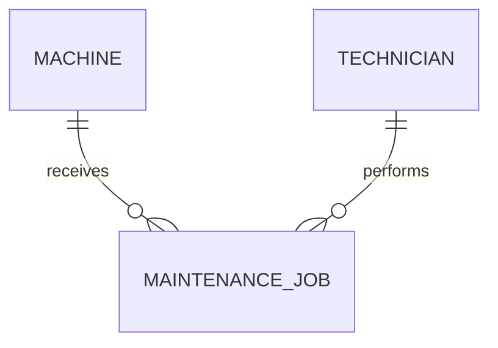
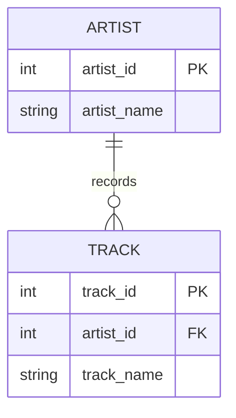

# Study log: data contracts and legacy schemas

This log contains Module 2 research references, an ER modeling study guide,
existing SQL and Python verification evidence, and notes from my personal study.
I studied the material for **one hour** on **15 October 2026** and also discussed
Module 2 with my Task Pod partner, **Tunay Daldaban**, for **15 minutes**.
The one-hour study and the 15-minute discussion are recorded separately because
the available information does not establish whether the discussion was included
within that hour.

We **did not attend the class session when Module 2 was assigned**. Therefore,
we did **not** carry out the required discussion with a **neighboring Task Pod**.
At that time we had **not yet joined the class Discord**, so we did not share a
Module 2 diagram there. Our own-pod discussion and reciprocal GitHub reviews are
recorded honestly; they are not presented as a completed neighboring-pod activity.
This statement is limited to the Module 2 ER task. I later participated in a
separate Module 3 SQL query-plan discussion with students from another group;
that later activity is not evidence that Module 2 Task C or its Discord step
was completed.

Some implementation and technical checks were prepared with AI assistance.
Saved SQL results and test records are portfolio evidence, not proof that I
personally executed every command. The informal personal-study explanations in
this log should be kept only to the extent that they match my actual experience.

## Learning references

| Source | Publisher | Concept and relevance |
|---|---|---|
| [Official Module 2 workbook](https://github.com/iotempire/iotempire-teaching/blob/main/full-classes/hsbi-databases-10d/modules/02-data-contracts-and-legacy-schemas.md) | IoT Empire / HSBI course material | Primary assignment specification and legacy fixture; it frames AI statements as hypotheses to test. |
| [Entity–relationship model](https://en.wikipedia.org/wiki/Entity%E2%80%93relationship_model) | Wikipedia contributors | Overview of entities, attributes, relationships, and common notation. Used as a starting reference, not as executable proof. |
| [Entity Relationship Diagrams](https://mermaid.js.org/syntax/entityRelationshipDiagram.html) | Mermaid project | Defines renderable ER syntax and crow's-foot markers used in this portfolio. |
| [Enhanced ER model](https://en.wikipedia.org/wiki/Enhanced_entity%E2%80%93relationship_model) | Wikipedia contributors | Explains generalization/specialization and subtype ideas beyond basic ER modeling. |
| [First normal form](https://en.wikipedia.org/wiki/First_normal_form) | Wikipedia contributors | Explains why a field should not contain a repeating list of part identifiers. |
| [SQLite foreign-key support](https://www.sqlite.org/foreignkeys.html) | SQLite project | Official explanation of parent/child keys and the need to enable enforcement per connection. |
| [SQLite CREATE TABLE](https://www.sqlite.org/lang_createtable.html) | SQLite project | Documents PRIMARY KEY, UNIQUE, NOT NULL, CHECK, and FOREIGN KEY constraints. |
| [Pydantic fields](https://docs.pydantic.dev/latest/concepts/fields/) and [validators](https://docs.pydantic.dev/latest/concepts/validators/) | Pydantic project | Basis for required fields, ranges, patterns, date parsing, and custom list validation. |
| [SQLAlchemy metadata](https://docs.sqlalchemy.org/en/21/core/metadata.html) and [constraints](https://docs.sqlalchemy.org/en/21/core/constraints.html) | SQLAlchemy project | Defines tables, columns, foreign keys, checks, uniqueness, and DDL creation. |
| [Natural key](https://en.wikipedia.org/wiki/Natural_key) and [Surrogate key](https://en.wikipedia.org/wiki/Surrogate_key) | Wikipedia contributors | Supplementary references for choosing stable real-world identifiers versus database-generated identifiers. |
| [SQLite datatypes and comparison rules](https://www.sqlite.org/datatype3.html) | SQLite project | Official explanation of type affinity, text comparisons, and numeric conversions used to interpret the price defect. |

## Questions and verified answers

The websites below are references supporting the answers. They were selected from
existing Module 2 references, supplemented by the linked natural/surrogate-key
and SQLite datatype documentation. The **portfolio evidence** column points to
checks recorded in this project; the reference links do not, by themselves,
prove which websites were personally browsed during a student study session.

| Question researched | Finding | Verification evidence in this portfolio | Relevant website/reference |
|---|---|---|---|
| Entity or attribute? | An entity needs its own identity, facts, or relationships; an attribute describes another entity. The choice depends on what the application must track. | [ER modeling examples](er-examples.md) and [legacy model reconstruction](er-audit.md), especially MaintenanceJob versus its date. | [Entity–relationship model](https://en.wikipedia.org/wiki/Entity%E2%80%93relationship_model) |
| When should a natural key be used? | Use a real-world identifier if it is genuinely unique, stable and suitable for references. Otherwise, a surrogate key can provide stable row identity while a natural business identifier stays `UNIQUE`. | [ER audit](er-audit.md) and [corrected schema](corrected-schema.sql): surrogate `machine_id`, unique `serial_no`, and natural `part_no`. | [Natural key](https://en.wikipedia.org/wiki/Natural_key), [Surrogate key](https://en.wikipedia.org/wiki/Surrogate_key) |
| Why are duplicate natural keys dangerous? | Two rows with the same supposed identifier make joins ambiguous and can double-count results. | [Integrity queries](integrity-audit.sql) and [recorded results](integrity-results.txt): `P-1003` appears twice and causes two matches in the naive join. | [SQLite PRIMARY KEY and UNIQUE constraints](https://www.sqlite.org/lang_createtable.html) |
| How do we model 1:1, 1:n and m:n? | Use a unique foreign key for an at-most-one child relationship, a foreign key on the many side for 1:n, and a junction table with two foreign keys and a composite/unique key for m:n. Minimum participation may require further rules. | [Four ER sketches](er-examples.md), [SQL proof](sketch-proof.sql), and [proof results](sketch-proof-results.txt). | [Mermaid ER cardinalities](https://mermaid.js.org/syntax/entityRelationshipDiagram.html), [SQLite foreign keys](https://www.sqlite.org/foreignkeys.html) |
| Why is `parts_used = 'P-1001,P-1002'` a normalization problem? | A comma-separated list stores several independent part identifiers in one column, making individual references hard to join, validate and constrain. A `job_part` junction table models the associations as rows. | [Legacy fixture](legacy_setup.sql), [defect query](integrity-audit.sql), and [integrity results](integrity-results.txt): job 1 disappears from the naive equality join. | [First normal form](https://en.wikipedia.org/wiki/First_normal_form), [official Module 2 workbook](https://github.com/iotempire/iotempire-teaching/blob/main/full-classes/hsbi-databases-10d/modules/02-data-contracts-and-legacy-schemas.md) |
| Why do missing foreign keys create orphans? | Without an enforced foreign-key relationship, a job can reference a machine that does not exist. | [Integrity query](integrity-audit.sql) and [results](integrity-results.txt): job 3 references nonexistent `cnc-05`. | [SQLite foreign-key support](https://www.sqlite.org/foreignkeys.html) |
| What does SQLite enforce automatically? | Declared primary-key, UNIQUE, NOT NULL and CHECK rules operate according to SQLite's constraint semantics; foreign-key enforcement must also be enabled for the connection. | [Corrected schema](corrected-schema.sql), [contract](contract.py) and [11-test suite](tests/test_contract.py), including the foreign-key rejection case. | [SQLite CREATE TABLE and constraints](https://www.sqlite.org/lang_createtable.html), [SQLite foreign-key enforcement](https://www.sqlite.org/foreignkeys.html) |
| What should the application validate? | Pydantic checks incoming values and business-level rules such as identifiers, actual calendar dates, nonnegative decimal prices and duplicate list entries; SQL constraints independently guard the rules declared in the database. | [Pydantic/SQLAlchemy contract](contract.py) and [test results](test-results.txt). | [Pydantic fields](https://docs.pydantic.dev/latest/concepts/fields/), [Pydantic validators](https://docs.pydantic.dev/latest/concepts/validators/), [SQLAlchemy constraints](https://docs.sqlalchemy.org/en/21/core/constraints.html) |

## LLM-assisted questions and checks

The four prompts below were already documented as part of Module 2's
AI-assisted technical preparation. For each, the answer is kept short and is
paired with **existing executable evidence or a primary technical reference**.
These checks are documented portfolio evidence, not a new claim that the student
personally executed every query or consulted every source.

### Prompt 1 — Recover entities and constraints

**Prompt**

> Given the supplied legacy schema, what entities and hidden relationships does
> it probably intend, and which relationships are actually enforced?

**Answer summary (2–3 lines):** The three original tables suggest the entities
Machine, Part and MaintenanceJob, with Technician hidden as a text value and
JobPart hidden in `parts_used`. Column names alone do not create SQL keys or
relationships; the legacy schema does not enforce those intended links.

**How the answer was checked:** [legacy_setup.sql](legacy_setup.sql) defines the
original three tables without declared foreign keys. The
[ER audit](er-audit.md) reconstructs the conceptual model. The
[orphan query](integrity-audit.sql) and [saved result](integrity-results.txt)
show that job 3 refers to `cnc-05`, which has no corresponding machine. The
original `maint_job` has no foreign keys (also recorded in the independent
SQLite sanity check below).

**Reference:** [SQLite foreign-key documentation](https://www.sqlite.org/foreignkeys.html)
and [Entity–relationship model](https://en.wikipedia.org/wiki/Entity%E2%80%93relationship_model).

**Important distinction:** An *intended* relationship is not an *enforced*
relationship. Four sample rows also cannot establish universal participation
rules.

### Prompt 2 — Normalize the part list

**Prompt**

> Why does parts_used = 'P-1001,P-1002' violate 1NF, and what corrected schema
> should replace it?

**Answer summary (2–3 lines):** One cell contains multiple separately
identifiable parts, making valid associations difficult to join and constrain.
The corrected design represents each job–part association as a row in
`job_part(job_id, part_no)` with two foreign keys and a composite primary key.

**How the answer was checked:** The
[legacy dataset](legacy_setup.sql) gives job 1 `P-1001,P-1002`. The
[naive join](integrity-audit.sql) misses that job entirely, as shown in
[integrity-results.txt](integrity-results.txt). The
[contract tests](tests/test_contract.py) check that a duplicate job–part pair
is rejected in the corrected model.

**Reference:** [First normal form](https://en.wikipedia.org/wiki/First_normal_form)
and [SQLite CREATE TABLE constraints](https://www.sqlite.org/lang_createtable.html).

**Limitation:** The old `parts_used` string does not specify quantity, so
quantities cannot be recovered from it without more evidence.

### Prompt 3 — Text prices and numeric comparisons

**Prompt**

> Is unit_price TEXT harmless in SQLite if all current values look numeric?

**Answer summary (2–3 lines):** No. A column storing prices as TEXT can be
compared lexicographically instead of numerically, depending on the operands
and SQLite's type-affinity rules. A comparison can execute without errors yet
return the wrong business result.

**How the answer was checked:** The
[integrity audit](integrity-audit.sql) and [results](integrity-results.txt)
show that the text predicate `unit_price < '15'` omits the `P-1003` records
priced at `9.90`. Numeric conversion changes that result. The following
minimal expression illustrates the difference:

```sql
SELECT '9.90' < '15' AS text_comparison;               -- 0
SELECT CAST('9.90' AS NUMERIC) < 15 AS numeric_check;  -- 1
```

**Reference:** [SQLite datatypes and comparison rules](https://www.sqlite.org/datatype3.html).

**Correction to an overbroad claim:** Not *all* numeric-looking TEXT
comparisons fail. The precise behavior depends on affinity and operands; this
fixture provides a concrete counterexample.

### Prompt 4 — Can a foreign key guarantee exactly one nameplate?

**Prompt**

> Can a foreign key and UNIQUE constraint guarantee every machine has exactly
> one nameplate?

**Answer summary (2–3 lines):** A non-null, unique foreign key in Nameplate
can ensure that each existing nameplate references one valid machine and that
a machine is referenced by at most one nameplate. It does **not** force every
machine to have a nameplate record.

**How the answer was checked:** The [Machine–Nameplate sketch](er-examples.md)
models the optionality, while [SQLite foreign-key support](https://www.sqlite.org/foreignkeys.html)
and [SQLite UNIQUE constraints](https://www.sqlite.org/lang_createtable.html)
explain the constraint semantics. The conclusion is based on schema and
documentation reasoning; this section does **not** claim a separate original
runtime test of mandatory parent participation.

**Remaining design choice:** Guaranteeing *exactly one* on both sides requires
an appropriate design or additional transaction/business rules, not just a
child-side foreign key and UNIQUE constraint.

## Two educational ER/EER examples

I included two sourced ER examples because they explain different parts of the
same problem: **reading relationships in a diagram** and **enforcing them in a
database**. The reasons below explain why these examples are useful for my
study notes. They do not claim that I presented them during the missed class.

### Example A — Mermaid property/room cardinality example

**Original source:** [Mermaid: Entity Relationship Diagrams](https://mermaid.js.org/syntax/entityRelationshipDiagram.html)
(Mermaid project; relationship syntax and cardinality notation).

**What the source shows:** Mermaid uses the example
`PROPERTY ||--|{ ROOM : contains` to show a property with one or more rooms,
where each room belongs to exactly one property. The symbols at both ends
express minimum and maximum participation.

**Why I selected this example for my study notes:** At first the
little symbols at the end of the lines looked confusing. This example made it
easier for me to read them: `||` means exactly one, `o{` means zero or more,
and `|{` means one or more. I liked that I could understand the relationship
from the picture before looking at any SQL.

**Redraw adapted to the Module 2 maintenance domain:**



**What this example teaches that Example B does not:** A visual model
communicates relationships and minimum/maximum participation before writing
SQL. For instance, the diagram says each maintenance job belongs to exactly
one machine, while a machine may have no jobs or many jobs. The diagram's
business intent is not by itself evidence that the legacy database enforces
those relationships.

**Source acknowledgment:** The relationship notation comes from the Mermaid
documentation. The machine/technician/maintenance-job drawing is a domain
adaptation, not an original Mermaid-site diagram.

### Example B — SQLite artist/track foreign-key example

**Original source:** [SQLite: Foreign Key Support](https://www.sqlite.org/foreignkeys.html)
(SQLite project; artist/track parent–child schema).

**What the source shows:** The `artist` table supplies a parent key and the
`track` table stores an `artistid` reference. SQLite uses foreign-key rules to
reject invalid child references when enforcement is enabled.

**Why I selected this example for my study notes:** I wanted a
simple example that goes one step beyond a drawing. The Artist–Track example
shows me where the foreign key belongs and why the database needs it. It also
helped me understand the `cnc-05` problem in our maintenance data: without a
real foreign-key rule, the database can accept a reference to something that
does not exist.

**Redraw with renamed column labels for readability:**



**What this example teaches that Example A does not:** The foreign key must
reference an appropriate parent key; the parent's identity must be unique;
and SQLite foreign-key enforcement must be enabled for the connection. This
helps explain why the legacy `maint_job.machine_name` column does not protect
against `cnc-05`, while the corrected Module 2 schema can.

**Source acknowledgment:** The artist/track relationship is adapted from the
official SQLite documentation; the diagram is a teaching redraw rather than
a screenshot of the original page.

## Remarkable technical findings

- A column named `job_id` was not a key because no constraint declared it.
- The naive part join both omitted one valid logical relationship and duplicated
  another result.
- NULL produced NULL, not zero, in the workbook's comma-count expression.
- ORM type declarations help bind values, but SQLite's dynamic type system
  still makes application validation and explicit checks valuable.


## Guided technical study of the five Module 2 files

The notes below explain the submitted files in an accessible way. This is a
**study resource**, not a fabricated first-person account of a study session.

### File 1 — `study-log.md`: the vocabulary behind the model

**Entity:** an identifiable thing worth storing as a record, such as a machine,
part, technician, or maintenance job.

**Attribute:** one fact about that entity, such as a machine's serial number,
installation date, or site. An installation date is not a separate entity
unless it needs its own identity or relationships.

**Relationship:** a connection between entities, such as a technician
performing a maintenance job or a job using a part.

**Primary key (PK):** a value or combination of values declared to identify
each database row uniquely. The original `maint_job.job_id` *looks* like a
primary key but was not declared as one.

**Natural key:** a real-world identifier, such as `part_no` or a machine serial
number. It needs a genuine uniqueness guarantee to function as a database key.

**Surrogate key:** an artificial ID, such as `machine_id`, which remains stable
when a machine's display name changes. A stable natural identifier can still
be declared `UNIQUE`.

**Foreign key (FK):** a column whose values must reference keys in another
table when foreign-key constraints are declared *and enforced*. For SQLite,
foreign-key enforcement must be enabled on each relevant connection.

**Junction table:** an association table used for many-to-many relationships.
`job_part(job_id, part_no)` represents individual job–part links and its
composite PK prevents the same part being recorded twice for one job.

### File 2 — `er-examples.md`: four diagrams and what they really mean

| Sketch | Meaning | What a table constraint can enforce | Important limitation |
|---|---|---|---|
| Machine–Nameplate (1:1) | Each machine is intended to have one nameplate. | A nameplate whose `machine_id` is PK and FK must point to an existing machine; no two nameplates can refer to one machine. | The FK does not require **every** machine to have a nameplate. |
| Machine–Sensor (1:n) | One machine can carry several sensors; a sensor belongs to one machine. | `sensor.machine_id NOT NULL REFERENCES machine` makes each sensor refer to an existing machine when FKs are enabled. | It does not require every machine to have one or more sensors. |
| WorkOrder–Part (m:n) | Orders can contain different parts, and each part can appear in different orders. | `work_order_part(order_id, part_no)` with a composite PK rejects duplicate pairs. | If an order line needs a quantity, the quantity belongs on the junction row. |
| MaintenanceJob (event entity) | A job takes place on a machine, is done by a technician, and has its own date. | Separate `MAINTENANCE_JOB` records have their own keys and FKs. | Assuming one technician per job is a business decision; multiple technicians would change the design. |

**Reading Mermaid:** `||` means exactly one at that end; `o{` means
zero or many; `|{` means one or many. A diagram can state a stronger business
requirement than the current SQL constraints enforce.

**One example to explain aloud:** "A maintenance job and a part have an m:n
relationship because one job may use multiple parts, while a part can appear
in many jobs. The junction table stores each link as a separate row."

### File 3 — `er-audit.md`: reading the legacy schema rather than trusting names

The original database has **three** physical tables (`machine`, `part`,
`maint_job`) with no declared primary keys, foreign keys, or uniqueness rules.
The corrected conceptual design introduces or makes explicit five entities:

| Entity | Role in corrected model | Identity choice |
|---|---|---|
| Machine | Equipment being maintained | `machine_id` PK; `serial_no` UNIQUE |
| Part | Replacement item | `part_no` PK |
| MaintenanceJob | Individual maintenance event | `job_id` PK; machine and technician FKs |
| Technician | Person who carries out a job | `technician_id` PK |
| JobPart | One part used in one job | composite `(job_id, part_no)` PK and two FKs |

A **column having the same name as another entity is not proof of a
relationship constraint**. For example, the original maintenance job can store
`cnc-05` even though no such machine exists.

The sample observations show that `cnc-01` has two jobs, job 1 lists two
parts, and `P-1001` occurs in two jobs. These counts are evidence about this
small dataset, not a guarantee that all future data will obey the same
maximum/minimum cardinalities.

**Design question to consider:** the corrected `contract.py` also marks
`technician.name` as UNIQUE. This simplifies identity management but is not a
universally valid real-world rule: two different technicians could have the
same name. A surrogate `technician_id` can identify them separately. The
student should decide whether name uniqueness is justified by this exercise's
requirements; the supplied documents do not establish that rule.

### File 4 — `integrity-audit.md`: five defects, five lessons

| Defect | Example in professor's fixture | Why it matters | Repair direction |
|---|---|---|---|
| Orphan job | Job 3 points to `cnc-05`, a missing machine. | Reports cannot confidently attach maintenance to a machine or site. | Valid machine foreign key. |
| Duplicate natural key | `P-1003` appears twice. | Ambiguous updates and double-counted joins. | Make `part_no` a PK or UNIQUE after reconciliation. |
| Price stored as TEXT | `'9.90'` is not selected by the text predicate `< '15'`. | Price filters can omit valid low-price parts. | Validate as Decimal, store numeric values and test constraints. |
| Invalid date | `RANDOM-NAME` has `installed = 'unknown'`. | Maintenance age and scheduling are unreliable. | Validate real dates and resolve legacy exceptions. |
| Comma-separated list | Job 1 contains `P-1001,P-1002`; a naive equality join misses it. | Incomplete maintenance history; duplicate part rows can also duplicate query results. | Split into individual `job_part` links. |

An important difference: *identifying a defect* is not the same as *repairing
it*. The deliberately broken fixture must remain available for the audit;
real legacy corrections require decisions about missing machines, duplicate
parts, and unknown dates.

### File 5 — `contract.py`: application versus database checks

**Pydantic (application-level validation)** checks Python input models
before database operations:

- machine ID is positive, serial starts with `SN-`, site is not empty, and
  installation date is parsed as a real calendar date;
- part number follows the defined pattern; part price is a nonnegative
  `Decimal` with two decimal places;
- maintenance job IDs are positive, completion date is real, and a part
  cannot appear twice in one job's input list.

**SQLAlchemy (database structure)** declares five SQLite tables and their
primary keys, foreign keys, UNIQUE constraints and some CHECK constraints.
The `make_engine()` connection listener executes
`PRAGMA foreign_keys = ON` for the database connections it creates.

**Why both are needed:** Pydantic validates application input; SQL constraints
protect data integrity when a different writer inserts directly into a
database. Neither layer should be assumed to enforce a rule it does not
actually specify. For example, `Date` in an SQLite column declaration is not
a complete calendar-validity guarantee for arbitrary raw SQL inserts.

**One reason to be cautious:** in the uploaded contract, `technician.name`
has a UNIQUE constraint. Whether two technicians may share a name is an
unresolved business-rule choice, not proof that the contract is invalid.

### Independent SQLite sanity check (AI-assisted, not student execution)

An earlier AI-assisted technical check reconstructed the **12 original fixture
rows** from the professor's supplied `CREATE TABLE` and `INSERT` statements in
a fresh in-memory SQLite database and ran the audit patterns. The recorded
outputs belong to that check; **they must not be presented as commands the
student personally ran**.

| Executed check | Observed output |
|---|---|
| Legacy row counts | machine: 4; part: 4; maint_job: 4 |
| Orphan-machine query | `(3, 'cnc-05')` |
| Duplicate-part query | `('P-1003', 2)` |
| Text price `< '15'` | only `('P-1001', '12.50')` |
| Numeric `CAST(unit_price AS NUMERIC) < 15` | `P-1001` once, `P-1003` twice |
| Invalid-date shape query | `('RANDOM-NAME', 'unknown')` |
| Naive job-to-part join | job 2 appears twice; job 3 once; job 1 is missing |
| Comma-count expression | job 1: 2; job 2: 1; job 3: 1; job 4: NULL |
| `PRAGMA foreign_key_list(maint_job)` | empty in the original legacy schema |

**How to verify personally:** recreate `legacy.db` using `legacy_setup.sql`,
run `integrity-audit.sql` and `cardinality-audit.sql` from the VS Code terminal,
and compare their outputs with `integrity-results.txt` and
`cardinality-results.txt`. Then run the local contract tests yourself. A
published test log is evidence of a recorded run, not proof that the student
personally executed it.

### Knowledge-check questions to answer without looking

1. Why is a column named `job_id` not automatically a primary key?
2. Which table should contain `machine_id`: Machine or Sensor, and why?
3. Why does the many-to-many Job–Part relationship need a junction table?
4. Why is `P-1003` a problem in the legacy Part table?
5. What does `PRAGMA foreign_keys = ON` change?
6. Why might a Mermaid drawing say "exactly one" when the SQL permits zero?
7. Which layer catches an invalid calendar date in the uploaded contract?
8. Why could `technician.name UNIQUE` be a questionable requirement?

After attempting each yourself, compare with the explanations above.

### Study guide for reviewing the material (not a timed attendance record)

The professor suggests about 30 minutes for Task A; I reported spending **one
hour** studying Module 2 concepts. The outline below is a guide to the topics
in this log, not an invented minute-by-minute account of what happened:

| Topic | Material to review |
|---|---|
| Basic vocabulary | Entities, attributes, relationships, and keys in this log. |
| ER examples | Four sketches in [er-examples.md](er-examples.md) and the two sourced examples above. |
| Legacy design | Three original tables and five intended logical entities in [er-audit.md](er-audit.md). |
| SQL integrity | Five queries and recorded results in [integrity-audit.md](integrity-audit.md). |
| Application versus database | Pydantic, SQLAlchemy, and constraints in [contract.py](contract.py). |


## Agreed learning (pod discussion)

### My Task Pod discussion — 15 October 2026

**Date:** 15 October 2026  
**Duration:** 15 minutes  
**Participants:** İsa Babayev and Tunay Daldaban  
**Type of activity:** Discussion inside our own Task Pod, **not** the neighboring-pod activity in Task C.

We could not attend the class when Module 2 was introduced, so Tunay and I
studied and discussed the material separately. We did not meet students from a
neighboring Task Pod on that occasion.

**What we worked from:** the Module 2 ER exercises and technical evidence in
[er-examples.md](er-examples.md), [er-audit.md](er-audit.md), and
[integrity-audit.md](integrity-audit.md). These contain the following four
sketches. I have not recorded which individual sketches we displayed during the
15-minute conversation, so the list below is our study material, not a claimed
attendance-by-diagram record:

1. **Machine–Nameplate (1:1):** one-to-one relationships and `UNIQUE` constraints.
2. **Machine–Sensor (1:n):** why a sensor has the machine foreign key.
3. **WorkOrder–Part (m:n):** how a junction table represents many-to-many links.
4. **MaintenanceJob–Machine–Technician:** entities, attributes and relationships.

#### Five example learning points from our in-pod study

Tunay and I had a 15-minute Module 2 discussion on 15 October 2026.
These are five **suggested conclusions** written in normal student language,
based on the diagrams and SQL checks in this portfolio. I can use them to
summarize our discussion **after checking with Tunay that we really agreed on
them**. They are not evidence of a discussion with a neighboring pod.

1. **Just calling a column an ID does not make it a key.** For example, the old
   `maint_job` table has a `job_id` column, but the database never declares it as
   a primary key. We need an actual constraint, not just a meaningful name.
2. **A diagram and a database are not always saying the same thing.** In an ER
   diagram we can draw a Machine–MaintenanceJob relationship, but unless the SQL
   defines and enforces a foreign key, the database may still accept a job with
   a machine that does not exist.
3. **Many-to-many relationships need a separate table.** A job may use several
   parts, and a part may be used in several jobs. Putting `P-1001,P-1002` in
   one text field causes problems; a `job_part` table makes the links clearer.
4. **SQL can return the wrong answer without showing an error.** We saw that
   job 1 disappears in the simple join, while the duplicated `P-1003` can make
   other rows appear more than once. This showed us why testing with real queries
   matters.
5. **Checking input and checking the database are different jobs.** Pydantic
   helps us reject invalid data before storing it. Primary keys, foreign keys,
   and other SQLite constraints help protect data in the database. Both are
   useful, but neither magically checks every possible rule.

#### Four example disagreements or different interpretations

A **disagreement** just means two people understand something differently at
first, or suggest different solutions. It does not have to be an argument. The
four examples below are **possible discussion examples, not a record of things
Tunay and I definitely disagreed about**. No actual unresolved disagreement
was reported from our 15-minute meeting. If we recognise a real disagreement,
we can replace the relevant example with what each of us genuinely said.

1. **Is Technician a separate entity, or just a text name?**
   - Possible view A: Storing the technician's name in `maint_job` is enough.
   - Possible view B: Technician should have its own table and ID.
   - What the model teaches: A separate Technician entity is useful when we need
     stable identity, details, or relationships across multiple jobs.
2. **Can we use the machine's name as its primary key?**
   - Possible view A: `cnc-01` is easy to recognise, so it can identify a row.
   - Possible view B: `machine_id` is safer if names can change.
   - What the model teaches: A surrogate `machine_id` is a reasonable design;
     `serial_no` should still be unique if it is a business identifier.
3. **Does `UNIQUE` plus a foreign key mean every machine has a nameplate?**
   - Possible view A: Yes, because it is a one-to-one relationship.
   - Possible view B: No, because a machine could still have no nameplate row.
   - What the model teaches: A child-side unique foreign key enforces *at most
     one* child for each parent, but does not automatically enforce *at least one*.
4. **Should part numbers stay in one comma-separated column?**
   - Possible view A: One text field is simpler because it uses fewer tables.
   - Possible view B: A junction table is better because each link is a row.
   - What the model teaches: The `job_part` design enables proper joins and
     key constraints; the legacy comma-separated field causes missing results.

**Actual disagreement record:** None was specifically documented. These
examples are provided as prompts to review with Tunay, not as statements of
what either of us personally said on 15 October.

#### Diagram selected for these study notes

**My chosen diagram:** **WorkOrder–Part (m:n)** in
[er-examples.md](er-examples.md).

I chose this diagram as a clear example for the record because it shows why
`work_order_part` is needed between WorkOrder and Part. One order can use many
parts, and the same part can appear in many orders. This is easier to see as a
diagram than as a comma-separated list in a database column.

**Joint selection:** This is my documented choice for our study notes. Tunay's
agreement to select it together has not been confirmed, so I am not claiming
that we jointly selected it or submitted it to the class.

#### Task C — Why we could not exchange with a neighboring pod

Unfortunately, we did not have a chance to discuss our diagrams or exchange
our work with another group because we did not attend the class session when
Module 2 was assigned. Instead, Tunay and I studied the module separately and
had our own 15-minute discussion on 15 October 2026.

This was **a discussion inside our own Task Pod**, not the neighboring-pod
exchange requested in Task C. Therefore, we cannot claim three to five points
jointly agreed with a second pod, a diagram jointly selected by two pods, or
feedback from another group.

We had not yet joined the course Discord at that time, so **we did not post an
ER diagram there**. There is no Discord image, message link, or screenshot to
provide for Module 2.

For these reasons, the neighboring-pod and Discord parts of Task C remain
**not completed**. We are documenting what actually happened instead of
claiming that these classroom activities took place. If the professor wants us
to complete Task C later, we can arrange a real exchange with another pod and
record that activity under its real date.

This Module 2 limitation does not mean that I never interacted with another
group in class: I later did so for Module 3 query-plan work. That separate
Module 3 activity does not retrospectively complete this ER-diagram task.

### Reciprocal GitHub peer review with Tunay

Our own-pod GitHub reviews are documented separately:

- [Review of my portfolio by Tunay — Issue #2](https://github.com/isa-babayev-ibabayev/databases-portfolio/issues/2)
- [My review of Tunay's portfolio — Issue #2](https://github.com/tunaydaldaban-beep/databases-portfolio/issues/2)

Those reviews provide evidence of collaboration inside our pod. They do not
replace the professor's neighboring-pod meeting or Discord post.

---

## My personal Module 2 study

**Date:** 15 October 2026  
**Study duration:** 1 hour (as reported)  
**Participant:** İsa Babayev for the personal study. I also had the separate
15-minute Module 2 discussion with Tunay described above.  
**Class attendance:** We did not participate in the class when Module 2 was given.

The following is a simple, everyday explanation of the learning experience.
The details should reflect what I actually understood and reviewed; it is not
a claim that I personally executed every SQL script or automated test.

### What I learned

I used to think that database design was mainly about creating tables. After
looking at the old maintenance database, I understood that the bigger question
is **what each table is supposed to represent**. A Machine and a Technician are
things we want to keep records about, while the date of a maintenance job is
just one piece of information about that job.

I also understand 1:1, 1:n and m:n better now. For example, a machine can have
many sensors, so the sensor has the machine's ID as a foreign key. A maintenance
job can use different parts, and one part can be used in many jobs, so we need
a separate table such as `job_part` instead of a list in one cell.

The main idea I took from the module is that an ER diagram explains how the
information should be connected, but the real keys and constraints are what
help the database check those connections.

### What surprised me

What surprised me was how a database problem can stay hidden even when a SQL
query runs without an error. In the old data, job 1 has `P-1001,P-1002` in one
field. When we use an ordinary equality join to Part, that job disappears from
the result because the whole string is not a single part number.

I also found it strange that job 3 could refer to `cnc-05` when that machine
was not even in the machine table. The duplicate `P-1003` was another good
example of why we cannot just trust the data to be clean.

### What was difficult

At first, I mixed up entities, attributes and relationships. I understood the
words, but choosing the right one for a real example was harder. Looking at
MaintenanceJob helped: the job needs its own record, while its date is simply
an attribute of the job.

I also had to think carefully about the difference between what a diagram says
and what SQL actually guarantees. For instance, a `UNIQUE` foreign key can stop
two nameplates belonging to the same machine, but it cannot automatically
make every machine have a nameplate.

The text-price example was confusing too. `9.90` looks like a number, but if
SQLite treats it as text, a comparison with `'15'` can give the wrong answer
for a price filter.

### How I checked my understanding

I read through the four diagrams in [er-examples.md](er-examples.md) and
compared them with the reconstructed design in [er-audit.md](er-audit.md).
That helped me understand why Technician and JobPart were missing from the
original three-table design.

For the database problems, I looked at the queries in
[integrity-audit.sql](integrity-audit.sql) and compared them with the saved
results in [integrity-results.txt](integrity-results.txt). I tried to explain
in simple words why `cnc-05` is an orphan reference, why `P-1003` leads to
duplicates, and why job 1 is missing from the bad join. I also reviewed
[contract.py](contract.py) to see the difference between Pydantic input checks
and SQLAlchemy/SQLite database constraints.

This is a review of existing code and recorded results. I am not claiming that
I ran every original SQL query or all the tests myself on 15 October.

### What I would explain to a classmate

"The original maintenance database had tables but was missing some important
relationships. We found actual problems with SQL queries instead of guessing.
The corrected model uses proper keys and a JobPart table. Pydantic helps check
input, and SQLite constraints help protect the database. We should always test
what the data and rules really do rather than just trust a diagram."
