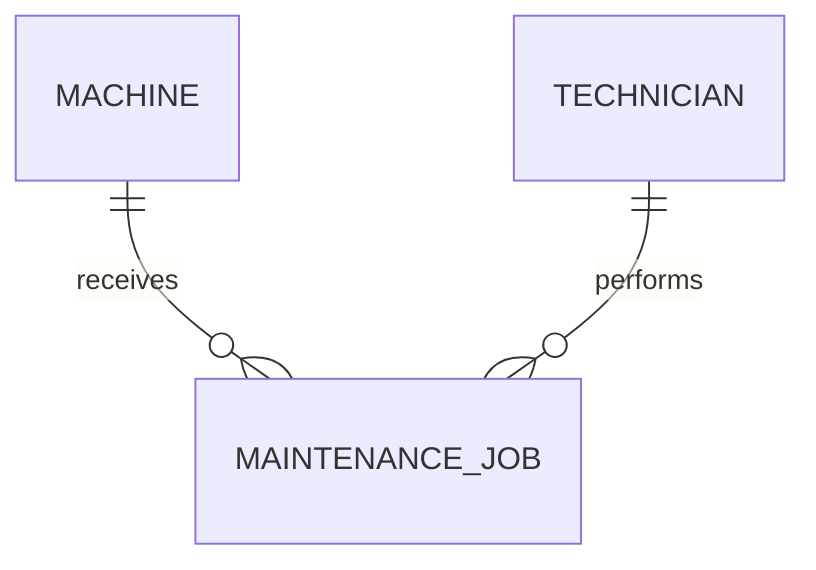
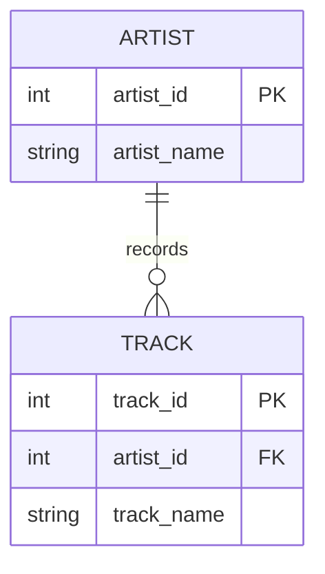

# Study log: data contracts and legacy schemas

This log combines the original Module 2 technical preparation with an additional
source-based study guide and an independent SQLite check of the professor's
legacy fixture. The new explanations and checks were prepared with AI assistance
for the student to **read, challenge, and confirm**. They are not evidence that
the student personally spent 30 minutes studying or attended a neighboring-pod
meeting.

The student has reported completing reciprocal GitHub peer reviews with Tunay;
the actual personal learning record and the professor's separate **neighboring
Task Pod** discussion must still be completed truthfully.

## Learning references

| Source | Publisher | Concept and relevance |
|---|---|---|
| [Official Module 2 workbook](https://github.com/iotempire/iotempire-teaching/blob/main/full-classes/hsbi-databases-10d/modules/02-data-contracts-and-legacy-schemas.md) | IoT Empire / HSBI course material | Primary assignment specification and legacy fixture; it frames AI statements as hypotheses to test. |
| [Entity–relationship model](https://en.wikipedia.org/wiki/Entity%E2%80%93relationship_model) | Wikipedia contributors | Overview of entities, attributes, relationships, and common notation. Used as a starting reference, not as executable proof. |
| [Entity Relationship Diagrams](https://mermaid.js.org/syntax/entityRelationshipDiagram.html) | Mermaid project | Defines renderable ER syntax and crow's-foot markers used in this portfolio. |
| [Enhanced ER model](https://en.wikipedia.org/wiki/Enhanced_entity%E2%80%93relationship_model) | Wikipedia contributors | Explains generalization/specialization and subtype ideas beyond basic ER modeling. |
| [First normal form](https://en.wikipedia.org/wiki/First_normal_form) | Wikipedia contributors | Explains why a field should not contain a repeating list of part identifiers. |
| [SQLite foreign-key support](https://www.sqlite.org/foreignkeys.html) | SQLite project | Official explanation of parent/child keys and the need to enable enforcement per connection. |
| [SQLite CREATE TABLE](https://www.sqlite.org/lang_createtable.html) | SQLite project | Documents PRIMARY KEY, UNIQUE, NOT NULL, CHECK, and FOREIGN KEY constraints. |
| [Pydantic fields](https://docs.pydantic.dev/latest/concepts/fields/) and [validators](https://docs.pydantic.dev/latest/concepts/validators/) | Pydantic project | Basis for required fields, ranges, patterns, date parsing, and custom list validation. |
| [SQLAlchemy metadata](https://docs.sqlalchemy.org/en/21/core/metadata.html) and [constraints](https://docs.sqlalchemy.org/en/21/core/constraints.html) | SQLAlchemy project | Defines tables, columns, foreign keys, checks, uniqueness, and DDL creation. |

## Questions and verified answers

| Question | Verified answer | Evidence type |
|---|---|---|
| Entity or attribute? | Give it an entity when it needs identity, lifecycle, attributes, or relationships of its own. Context decides borderline cases. | Reference plus MaintenanceJob design |
| When use a natural key? | When it is stable, compact, known, and truly unique. Otherwise use a surrogate and retain UNIQUE on the business identifier. | Reference and corrected DDL |
| Why are duplicate natural keys dangerous? | One identifier resolves to multiple rows, causing ambiguous updates and duplicate join results. | Experiment: P-1003 yields two join rows |
| How model 1:1, 1:n, m:n? | UNIQUE FK; FK on many side; junction table with two FKs and unique/composite key, respectively. | Four sketches and SQL |
| Why does a comma list violate 1NF? | One column stores multiple independent part values, so each cannot be keyed or constrained. | Reference and failed naive join |
| Why do missing FKs create orphans? | Text can be inserted without a matching parent. | Experiment: job 3 / cnc-05 |
| What does SQLite enforce automatically? | Declared PK, UNIQUE, NOT NULL, and CHECK rules; FK enforcement must be enabled for each connection. | SQLite docs and `foreign_keys=1` run |
| What must the application validate? | Input shape and domain semantics such as prefixes, calendar dates, decimal bounds, and duplicate list items; the DB still validates shared integrity. | Pydantic and database tests |

## LLM-assisted questions and checks

These exact prompts were answered during implementation. Summaries are not
accepted as proof; each was checked against SQL or documentation.

### Prompt 1

> Given the supplied legacy schema, what entities and hidden relationships does
> it probably intend, and which relationships are actually enforced?

Response summary: Machine, Part, MaintenanceJob, and implied Technician were
identified, with JobPart needed for the hidden m:n. The response warned that
matching column names are not constraints. Verification: `sqlite_master`
showed no keys or foreign keys, and job 3 proved an orphan can exist. No
unsupported relationship was treated as enforced.

### Prompt 2

> Why does parts_used = 'P-1001,P-1002' violate 1NF, and what corrected schema
> should replace it?

Response summary: the field contains multiple values and should become
`job_part(job_id, part_no)`. Verification: the naive equality join lost job 1;
the corrected composite primary key test rejected a duplicate pair. Ambiguity:
the legacy field does not record quantity, so quantity cannot be reconstructed.

### Prompt 3

> Is unit_price TEXT harmless in SQLite if all current values look numeric?

Response summary: no; comparisons may use text ordering and SQLite type
affinity is not domain validation. Verification: `'9.90' < '15'` returned 0,
while casting both to numeric logic returned 1. The initial broad claim
“numeric comparisons always fail” would be too strong: behavior depends on
operands and affinity, so the recorded counterexample is the precise evidence.

### Prompt 4

> Can a foreign key and UNIQUE constraint guarantee every machine has exactly
> one nameplate?

Response summary: they guarantee that a nameplate has a valid machine and at
most one nameplate can point to that machine, but cannot force creation of a
child row for every parent. Verification: this follows from the direction of
the FK and SQLite constraint semantics. “Exactly one” needs a combined table or
additional transactional/business enforcement.

## Two educational ER/EER examples

### Example A: Mermaid customer/property delivery example

Source and attribution: [Mermaid ER diagram documentation](https://mermaid.js.org/syntax/entityRelationshipDiagram.html),
Mermaid project. Its examples demonstrate relationship labels, attributes, and
crow's-foot cardinality. The useful lesson is that the two ends independently
express minimum and maximum participation.

Redraw adapted to this domain:

### Example B: SQLite artist/track foreign-key example

Source and attribution: [SQLite Foreign Key Support](https://www.sqlite.org/foreignkeys.html),
SQLite project. The official example distinguishes parent and child keys and
shows how a track references an artist. The lesson not visible in a purely
conceptual diagram is that the child FK must reference a unique parent key and
enforcement must be enabled.

Attributed redraw:

## Remarkable technical findings

- A column named `job_id` was not a key because no constraint declared it.
- The naive part join both omitted one valid logical relationship and duplicated
  another result.
- NULL produced NULL, not zero, in the workbook's comma-count expression.
- ORM type declarations help bind values, but SQLite's dynamic type system
  still makes application validation and explicit checks valuable.

## Guided technical study of the five Module 2 files

The notes below explain the submitted files in an accessible way. This is a
**study resource**, not a fabricated first-person account of a study session.

### File 1 — `study-log.md`: the vocabulary behind the model

**Entity:** an identifiable thing worth storing as a record, such as a machine,
part, technician, or maintenance job.

**Attribute:** one fact about that entity, such as a machine's serial number,
installation date, or site. An installation date is not a separate entity
unless it needs its own identity or relationships.

**Relationship:** a connection between entities, such as a technician
performing a maintenance job or a job using a part.

**Primary key (PK):** a value or combination of values declared to identify
each database row uniquely. The original `maint_job.job_id` *looks* like a
primary key but was not declared as one.

**Natural key:** a real-world identifier, such as `part_no` or a machine serial
number. It needs a genuine uniqueness guarantee to function as a database key.

**Surrogate key:** an artificial ID, such as `machine_id`, which remains stable
when a machine's display name changes. A stable natural identifier can still
be declared `UNIQUE`.

**Foreign key (FK):** a column whose values must reference keys in another
table when foreign-key constraints are declared *and enforced*. For SQLite,
foreign-key enforcement must be enabled on each relevant connection.

**Junction table:** an association table used for many-to-many relationships.
`job_part(job_id, part_no)` represents individual job–part links and its
composite PK prevents the same part being recorded twice for one job.

### File 2 — `er-examples.md`: four diagrams and what they really mean

| Sketch | Meaning | What a table constraint can enforce | Important limitation |
|---|---|---|---|
| Machine–Nameplate (1:1) | Each machine is intended to have one nameplate. | A nameplate whose `machine_id` is PK and FK must point to an existing machine; no two nameplates can refer to one machine. | The FK does not require **every** machine to have a nameplate. |
| Machine–Sensor (1:n) | One machine can carry several sensors; a sensor belongs to one machine. | `sensor.machine_id NOT NULL REFERENCES machine` makes each sensor refer to an existing machine when FKs are enabled. | It does not require every machine to have one or more sensors. |
| WorkOrder–Part (m:n) | Orders can contain different parts, and each part can appear in different orders. | `work_order_part(order_id, part_no)` with a composite PK rejects duplicate pairs. | If an order line needs a quantity, the quantity belongs on the junction row. |
| MaintenanceJob (event entity) | A job takes place on a machine, is done by a technician, and has its own date. | Separate `MAINTENANCE_JOB` records have their own keys and FKs. | Assuming one technician per job is a business decision; multiple technicians would change the design. |

**Reading Mermaid:** `||` means exactly one at that end; `o{` means
zero or many; `|{` means one or many. A diagram can state a stronger business
requirement than the current SQL constraints enforce.

**One example to explain aloud:** "A maintenance job and a part have an m:n
relationship because one job may use multiple parts, while a part can appear
in many jobs. The junction table stores each link as a separate row."

### File 3 — `er-audit.md`: reading the legacy schema rather than trusting names

The original database has **three** physical tables (`machine`, `part`,
`maint_job`) with no declared primary keys, foreign keys, or uniqueness rules.
The corrected conceptual design introduces or makes explicit five entities:

| Entity | Role in corrected model | Identity choice |
|---|---|---|
| Machine | Equipment being maintained | `machine_id` PK; `serial_no` UNIQUE |
| Part | Replacement item | `part_no` PK |
| MaintenanceJob | Individual maintenance event | `job_id` PK; machine and technician FKs |
| Technician | Person who carries out a job | `technician_id` PK |
| JobPart | One part used in one job | composite `(job_id, part_no)` PK and two FKs |

A **column having the same name as another entity is not proof of a
relationship constraint**. For example, the original maintenance job can store
`cnc-05` even though no such machine exists.

The sample observations show that `cnc-01` has two jobs, job 1 lists two
parts, and `P-1001` occurs in two jobs. These counts are evidence about this
small dataset, not a guarantee that all future data will obey the same
maximum/minimum cardinalities.

**Design question to consider:** the corrected `contract.py` also marks
`technician.name` as UNIQUE. This simplifies identity management but is not a
universally valid real-world rule: two different technicians could have the
same name. A surrogate `technician_id` can identify them separately. The
student should decide whether name uniqueness is justified by this exercise's
requirements; the supplied documents do not establish that rule.

### File 4 — `integrity-audit.md`: five defects, five lessons

| Defect | Example in professor's fixture | Why it matters | Repair direction |
|---|---|---|---|
| Orphan job | Job 3 points to `cnc-05`, a missing machine. | Reports cannot confidently attach maintenance to a machine or site. | Valid machine foreign key. |
| Duplicate natural key | `P-1003` appears twice. | Ambiguous updates and double-counted joins. | Make `part_no` a PK or UNIQUE after reconciliation. |
| Price stored as TEXT | `'9.90'` is not selected by the text predicate `< '15'`. | Price filters can omit valid low-price parts. | Validate as Decimal, store numeric values and test constraints. |
| Invalid date | `RANDOM-NAME` has `installed = 'unknown'`. | Maintenance age and scheduling are unreliable. | Validate real dates and resolve legacy exceptions. |
| Comma-separated list | Job 1 contains `P-1001,P-1002`; a naive equality join misses it. | Incomplete maintenance history; duplicate part rows can also duplicate query results. | Split into individual `job_part` links. |

An important difference: *identifying a defect* is not the same as *repairing
it*. The deliberately broken fixture must remain available for the audit;
real legacy corrections require decisions about missing machines, duplicate
parts, and unknown dates.

### File 5 — `contract.py`: application versus database checks

**Pydantic (application-level validation)** checks Python input models
before database operations:

- machine ID is positive, serial starts with `SN-`, site is not empty, and
  installation date is parsed as a real calendar date;
- part number follows the defined pattern; part price is a nonnegative
  `Decimal` with two decimal places;
- maintenance job IDs are positive, completion date is real, and a part
  cannot appear twice in one job's input list.

**SQLAlchemy (database structure)** declares five SQLite tables and their
primary keys, foreign keys, UNIQUE constraints and some CHECK constraints.
The `make_engine()` connection listener executes
`PRAGMA foreign_keys = ON` for the database connections it creates.

**Why both are needed:** Pydantic validates application input; SQL constraints
protect data integrity when a different writer inserts directly into a
database. Neither layer should be assumed to enforce a rule it does not
actually specify. For example, `Date` in an SQLite column declaration is not
a complete calendar-validity guarantee for arbitrary raw SQL inserts.

**One reason to be cautious:** in the uploaded contract, `technician.name`
has a UNIQUE constraint. Whether two technicians may share a name is an
unresolved business-rule choice, not proof that the contract is invalid.

### Independent SQLite sanity check (AI-assisted, not student execution)

I reconstructed the **12 original fixture rows** from the professor's supplied
`CREATE TABLE` and `INSERT` statements in a fresh in-memory SQLite database,
then independently ran the audit patterns. These are actual results of that
check, but **do not label them as commands personally run by the student**.

| Executed check | Observed output |
|---|---|
| Legacy row counts | machine: 4; part: 4; maint_job: 4 |
| Orphan-machine query | `(3, 'cnc-05')` |
| Duplicate-part query | `('P-1003', 2)` |
| Text price `< '15'` | only `('P-1001', '12.50')` |
| Numeric `CAST(unit_price AS NUMERIC) < 15` | `P-1001` once, `P-1003` twice |
| Invalid-date shape query | `('RANDOM-NAME', 'unknown')` |
| Naive job-to-part join | job 2 appears twice; job 3 once; job 1 is missing |
| Comma-count expression | job 1: 2; job 2: 1; job 3: 1; job 4: NULL |
| `PRAGMA foreign_key_list(maint_job)` | empty in the original legacy schema |

**How to verify personally:** recreate `legacy.db` using `legacy_setup.sql`,
run `integrity-audit.sql` and `cardinality-audit.sql` from the VS Code terminal,
and compare their outputs with `integrity-results.txt` and
`cardinality-results.txt`. Then run the local contract tests yourself. A
published test log is evidence of a recorded run, not proof that the student
personally executed it.

### Knowledge-check questions to answer without looking

1. Why is a column named `job_id` not automatically a primary key?
2. Which table should contain `machine_id`: Machine or Sensor, and why?
3. Why does the many-to-many Job–Part relationship need a junction table?
4. Why is `P-1003` a problem in the legacy Part table?
5. What does `PRAGMA foreign_keys = ON` change?
6. Why might a Mermaid drawing say "exactly one" when the SQL permits zero?
7. Which layer catches an invalid calendar date in the uploaded contract?
8. Why could `technician.name UNIQUE` be a questionable requirement?

After attempting each yourself, compare with the explanations above.

### Suggested 30-minute study route (a plan, not a completed attendance log)

| Minutes | Activity |
|---|---|
| 0–8 | Read the key definitions, references, and original LLM verification notes. |
| 8–16 | Inspect the four sketches and explain each cardinality aloud. |
| 16–21 | Compare the original three tables with the five-entity corrected model. |
| 21–26 | Understand how each of the five SQL defect queries proves its claim. |
| 26–30 | Compare Pydantic with SQLAlchemy and answer the eight questions above. |

## Agreed learning (pod discussion)

### Confirmed in-pod work: reciprocal GitHub peer review

The student reports that **both pod partners have reviewed and commented on each
other's Module 2 repositories**. The discussions can be reviewed at:

- [Review of this portfolio by Tunay — Issue #2](https://github.com/isa-babayev-ibabayev/databases-portfolio/issues/2)
- [Review of Tunay's portfolio — Issue #2](https://github.com/tunaydaldaban-beep/databases-portfolio/issues/2)

These are links to the peer-review evidence; the student should confirm that
the precise findings summarized in those Issues reflect the actual exchange.
The uploaded files show a meaningful discussion topic: a DATE column's format
or type declaration is not sufficient to guarantee real calendar-date validity
for arbitrary SQLite inserts, while Pydantic can validate `date` inputs.

**Important:** an in-pod review with Tunay is **not** the same as the professor's
separate Task C conversation with a **neighboring pod**.

### Neighboring-pod discussion — factual record to complete

**Status: NOT VERIFIED; do not mark as held until the students confirm the
meeting and its actual content.**

- Date and duration: **TO BE FILLED AFTER THE REAL DISCUSSION**
- Other pod / participants: **TO BE FILLED**
- Which ER sketches were shown: **TO BE FILLED**
- Three to five points genuinely agreed by both pods: **TO BE FILLED**
- Open disagreements / points that needed clarification: **TO BE FILLED**
- Selected diagram and why: **TO BE FILLED**
- Actual Discord post link or screenshot: **TO BE FILLED**

**Candidate discussion ideas (not agreed findings):**

1. A natural identifier is not an enforced natural key without a uniqueness
   constraint.
2. Cardinalities inferred from four example rows are not universal business
   limits.
3. SQLite foreign keys need declared constraints and enabled enforcement.
4. Multi-valued part strings need a relational junction table.
5. Validation at the application layer and integrity constraints in the
   database solve related but different problems.

Suggested diagram to consider: the corrected model in
[er-audit.md](er-audit.md).

Suggested Discord caption to discuss with the other pod:
"We selected this diagram because it makes the hidden job–part
many-to-many relationship explicit and explains how keys and foreign keys
protect the corrected database."